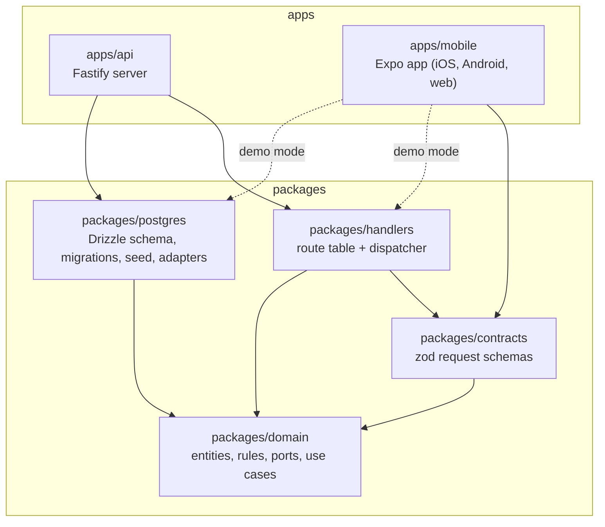
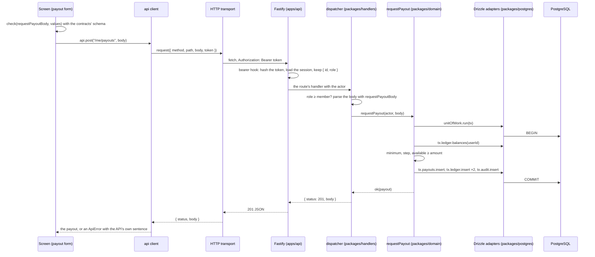
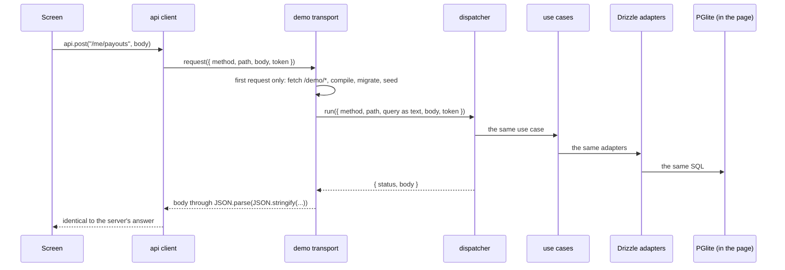
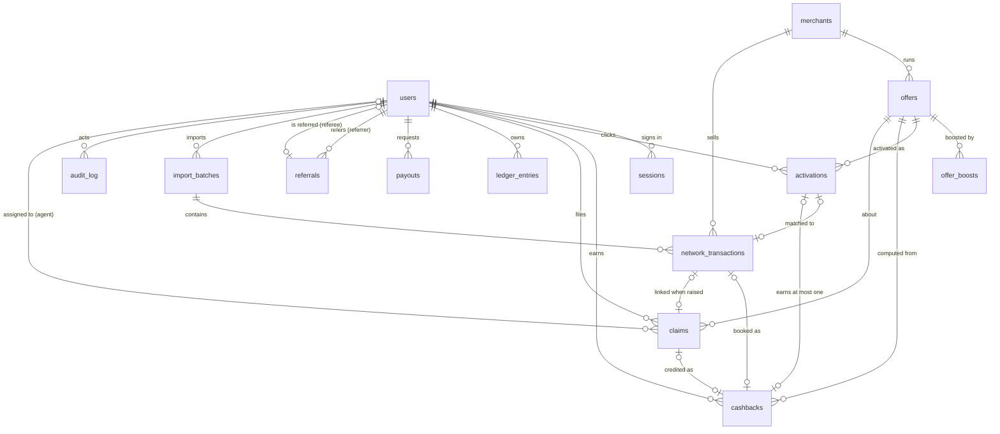
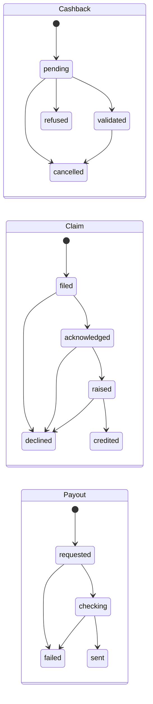
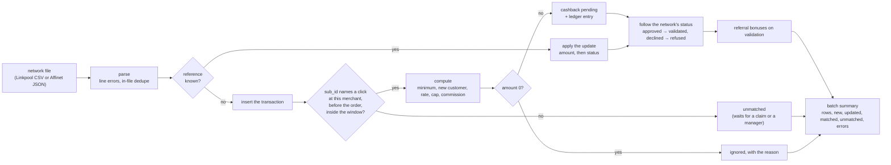
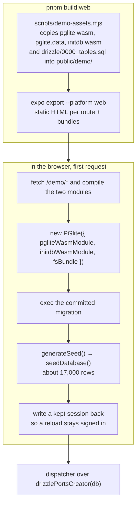

# Architecture

How the pieces fit: the packages and what each may import, the path a request takes on the server and in the demo, the data model, and how the demo runs PostgreSQL in the page. The rules themselves are in `domain.md`; the routes are in `api.md`; the reasons behind the choices are in `decisions/`.

## Components

Four packages and two apps in one pnpm workspace. The arrows are the only imports allowed; `packages/domain` imports nothing from the workspace and no framework.

`packages/domain` holds the entities, the money and rate arithmetic, the seven transition tables, the settlement pipeline, the ports (repositories, a unit of work, a clock, an id generator) as interfaces, an in-memory implementation of them for tests, and the use cases as factories that take their ports. A use case returns a `Result`: `ok(value)` or `fail(code, message)`, with six codes that map one to one onto HTTP statuses, so a refusal is a value that can travel to a screen without a server in between.

`packages/contracts` is every request body and query as a zod schema. The route table parses with them, and the app's forms run the same schema before sending, so a member is refused with the same words on the phone and from the API.

`packages/postgres` is the Drizzle schema (fourteen tables, sixteen enums, the checks and unique constraints), the generated migration in `drizzle/`, the seed generator (about 17,000 coherent rows from a fixed seed), and `drizzlePortsCreator`, which implements the domain's ports over a Drizzle handle. The handle is node-postgres on the server and PGlite in tests and in the browser; the adapters do not know which.

`packages/handlers` is the API as data: fifty-three rows of method, path, least role, the schema to parse with, the use case to call and the success status. `dispatcherCreator` turns the table into one function that finds the route, checks the token and the role before anything is looked up, parses, calls and maps the result to a status and a body. The server registers the table with Fastify; the demo calls the dispatcher directly.

`apps/api` is the server's composition root: the only folder where a Fastify request or reply exists. It connects to PostgreSQL, applies the migrations, loads the seed when `SEED=1`, builds the use cases over the Drizzle adapters, and registers the route table behind a bearer hook, helmet, CORS from `WEB_ORIGIN` and a rate limit on `/auth/*`.

`apps/mobile` is the app. A screen asks hooks (TanStack Query, one per route); the hooks ask one client; the client asks a transport. The HTTP transport is `fetch` against `EXPO_PUBLIC_API_URL`; the demo transport is the dispatcher over PGlite in the page. Navigation sits behind a small interface the root layout implements with Expo Router, so a screen never imports the router and can be rendered in a test with a fake transport and a fake navigation.

## A request, on the server

`POST /me/payouts` from a signed-in member, as the code runs it.

The order of refusals is fixed by the dispatcher: 404 for no such route, 401 for no or a dead token, 403 for a role below the route's, all before the body is read; then a 400 with one line per field when the schema refuses the shape; then whatever the use case returns, 409 for a move the state machine forbids, 422 for a rule, 404 for a record that does not exist, 403 for one that belongs to another member. Every write that a use case makes goes through `unitOfWork.run`, which is one database transaction: the payout, its two ledger entries and its audit row land together or not at all.

## The same request, in the demo

Everything from the dispatcher down is the same code the server runs. Two things are the transport's own: the query is carried as text, because a URL carries text and the schemas coerce from it; and the body goes through a JSON round trip so a screen receives dates as ISO strings in both modes. What the demo lacks is Fastify's: the rate limit, CORS and the request log.

## The data model

Fourteen tables. Money is integer cents, rates are integer basis points, every state is a PostgreSQL enum, times are `timestamptz`.

The relations that carry the business:

- An **activation** is a click: the member, the offer, the instant, a fresh `sub_id` (unique) and `rate_bps`, the rate in force at that instant, snapshotted because boosts are temporary.
- A **network transaction** is the network's word about a sale, unique on `(network, network_ref)` across every file ever imported. Its `match_status` says whether it names an activation (`matched`), names nobody (`unmatched`) or was set aside (`ignored`, with a reason).
- A **cashback** is derived: from an activation and a transaction by the pipeline, or from a claim by an agent. `unique(activation_id)` makes one click earn at most one cashback. `decided_by` says whose word its status follows: the network's, a manager's or a claim's.
- **Ledger entries** are append-only, with a `bucket` (`pending`, `available`, `reserved`, `paid`), a `kind` (ten of them, from `cashback_pending` to `payout_failed`) and a signed `amount_cents`. A member's balance in a bucket is the sum of their entries in it, computed on every request; there is no balance column. Each entry points back at the cashback, payout, claim or referral that caused it.
- A **claim** stands on an activation the member really made (checked when it is filed), may link an unmatched transaction when an agent raises it, and ends as a cashback with a `manual_credit` entry or as a decline with a reason.
- A **payout** reserves its amount on request (`available → reserved`) and moves it to `paid` when sent or back to `available` when it fails.
- A **referral** pays once the referee's validated cashbacks reach 5 €, and a 10 % share to the referrer until `bonus_until`.
- Every transition writes an **audit_log** row: actor, action, entity, before, after, reason.

The constraints that the database enforces under the code: foreign keys on every relation above, `unique(email)`, `unique(referral_code)`, `unique(sub_id)`, `unique(network, network_ref)`, `unique(activation_id)` on cashbacks, one referral per referee, `rate_bps between 0 and 10000`, non-negative money where it must be, a positive payout amount, `ends_at > starts_at` on a boost, and a percent offer carrying no fixed amount and a fixed one no rate.

## The state machines

Seven, as tables in `packages/domain/src/transitions.ts`; a use case asks `move(table, from, to)` before touching anything, so a forbidden move is a 409 and never a row.

The others: an offer goes `draft → live → paused → live` and `live | paused → ended`; a transaction's match goes `unmatched → matched | ignored` and `ignored → matched`; a referral goes `pending → validated | expired`; an import batch goes `received → processed | failed`. `domain.md` has each with its rules.

## The settlement pipeline

One file in, one batch out, as one database transaction. The batch row is written before the transaction opens, so a crash leaves a `failed` batch with its reason rather than a file that seems never to have arrived.

The manual paths (a manager matching by hand, a claim being credited, a manager validating or refusing) call the same `bookTransaction` and `changeStatus` the pipeline calls, so the ledger cannot tell who decided. `GET /reports/reconciliation` recomputes the whole book from the entries and checks every cashback and payout against what its status says; the same checks run in the tests after every step of random histories.

## Demo mode

The live demo is the web export of the app with `EXPO_PUBLIC_API_URL` empty. There is no server behind it.

PGlite's own loader finds its files next to its script with `import.meta.url`, which Metro rewrites, so the app hands it the compiled modules and the data bundle as options and the loader never computes a URL. Metro resolves the Node modules PGlite reaches for in branches the browser never runs (`fs`, `zlib`, `util`, `node:module`) to empty modules in the browser bundle and keeps them for the static render, which runs in Node. The database module is imported lazily on the first request, so the bundle that paints the sign-in screen does not carry the engine. The data lives until the tab is closed; every visit starts from the seed.

## Tests, by layer

| Layer | Runner | Against | What |
| --- | --- | --- | --- |
| `packages/domain` | Vitest, fast-check | in-memory ports | money and rates, the transition tables, every use case, the parsers on the fixtures, matching and computation as properties, the ledger invariants over random histories |
| `packages/contracts` | Vitest | — | the schemas' coercions and limits |
| `packages/postgres` | Vitest | PGlite | the seed's determinism and coherence, the adapters through the same contract test as the in-memory ports, the reconciliation sums |
| `packages/handlers` | Vitest | in-memory ports | the dispatcher's order of refusals and the status table |
| `apps/api` | Vitest | PGlite with the seed | the access matrix for every route, the member, support and operations workflows, the pipeline's routes |
| `apps/mobile` | Vitest, Testing Library, jsdom | a fake transport | every screen as the member or the manager uses it; the demo transport on PGlite in the process |
| `apps/mobile/e2e` | Playwright | the demo build in Chromium | earn and cash out; claim to credit across three sign-ins; import, match by hand, validate |

`pnpm test` runs the first six; `pnpm build:web && pnpm test:e2e` the last.
